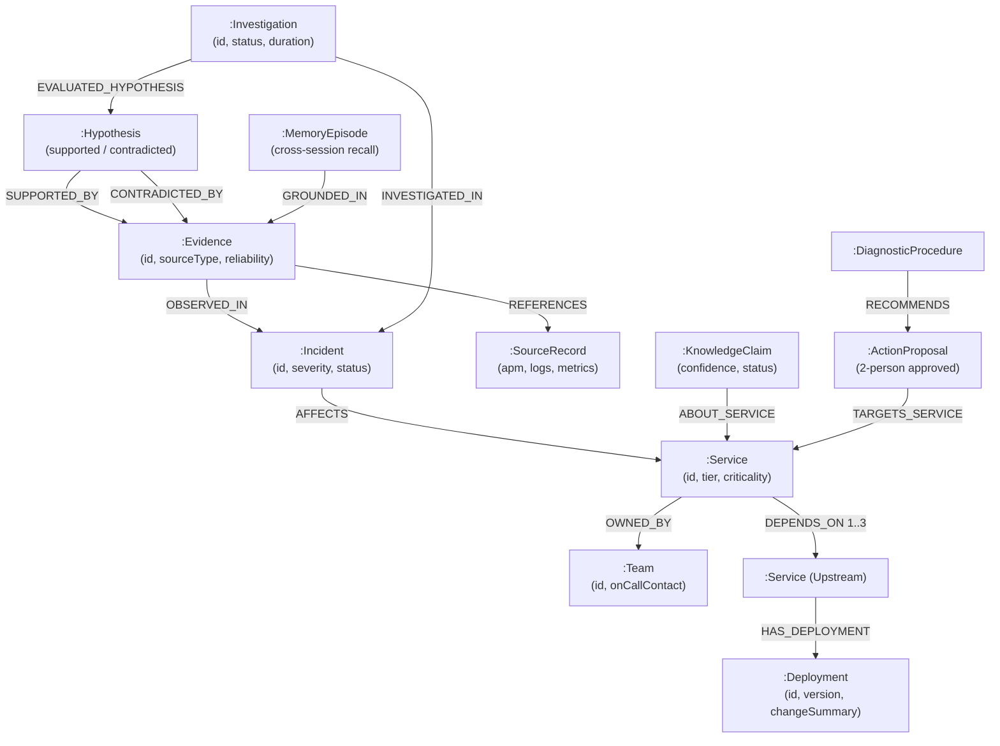

# NEUTRINO — Graph-Native AI Investigation Platform

> **Live Production Platform**: [https://neutrino-api-tzkg.onrender.com](https://neutrino-api-tzkg.onrender.com)  
> **Source Repository**: [https://github.com/sanstack256/Neutrino](https://github.com/sanstack256/Neutrino)  
> **Competition**: Graph Hacks — Context for AI Agents, powered by FalkorDB  
> **Primary Track**: Track 01 — *Agents That Act on Connected Data*  
> **Additional Tracks**: Track 02 — *Agent Memory and Coordination*; Track 03 — *Company Brain*  
> **Status**: Stage 5 Finished Deliverable — Fully hardened, verified, and live on FalkorDB Cloud.

[](https://neutrino-api-tzkg.onrender.com)
[](https://neutrino-api-tzkg.onrender.com/api/v1/graph/health)
[]()
[]()
[]()

---

## 🏆 Graph Hacks 2026 Submission Summary

| Requirement (Rule 10) | Verified Submission Asset | Location / Evidence |
|---|---|---|
| **1. Public Source Repository** | GitHub Public Repository | [https://github.com/sanstack256/Neutrino](https://github.com/sanstack256/Neutrino) |
| **2. Tracks Entered** | Primary: Track 01 (*Agents That Act on Connected Data*)<br>Track 02 (*Agent Memory and Coordination*)<br>Track 03 (*Company Brain*) | Stated above & detailed in [Section 17](#17-graph-hacks-track-alignment) |
| **3. Live Deployment** | Full Interactive Web UI + Production API hosted on Render | [https://neutrino-api-tzkg.onrender.com](https://neutrino-api-tzkg.onrender.com) |
| **4. FalkorDB Integration** | FalkorDB Cloud (AWS `ap-south-1`) with TLS + Local Docker Compose | Live Cluster Status: [`/api/v1/graph/health`](https://neutrino-api-tzkg.onrender.com/api/v1/graph/health) |
| **5. Graph Data Model** | 14 Node Labels, 20 Relationship Types, Schema Visualizer | [Section 6](#6-graph-data-model--schema) & [`docs/graph-model.md`](docs/graph-model.md) |
| **6. Cypher Queries & Algorithms** | Multi-hop dependency traversal, centrality, memory recall | [Section 7](#7-core-cypher-queries-and-graph-algorithms) & [`docs/cypher-algorithms.md`](docs/cypher-algorithms.md) |
| **7. Judge Testing Guide & Demo** | 3–5 minute step-by-step judge demonstration guide | [Section 2](#2-️-judge-evaluation--quick-testing-guide-3-minute-walkthrough) & [`docs/demo-script.md`](docs/demo-script.md) |
| **8. Local Setup Instructions** | Complete offline setup with Docker Compose & Cloud options | [Section 11](#11-quick-start--local-setup) |
| **9. AI Assistance Disclosure** | Disclosed in full accordance with Rule 11 | [Section 16](#16-ai-assisted-development-disclosure) |
| **10. Graph Indispensability Proof** | Automated tests proving severed graph edges alter conclusions | `pnpm test:indispensability` (Gate D/E) |

---

## 1. Live Deployment & Endpoints

| Resource | Environment | URL / Host | Description |
|---|---|---|---|
| **Interactive Web UI** | Production (Render) | [https://neutrino-api-tzkg.onrender.com](https://neutrino-api-tzkg.onrender.com) | Full Linear & Sentry-inspired investigation platform |
| **Graph Health API** | Production (Render) | [https://neutrino-api-tzkg.onrender.com/api/v1/graph/health](https://neutrino-api-tzkg.onrender.com/api/v1/graph/health) | Live FalkorDB cluster connectivity & topology status |
| **API Root** | Production (Render) | [https://neutrino-api-tzkg.onrender.com/api/v1/health](https://neutrino-api-tzkg.onrender.com/api/v1/health) | Production health & readiness probes |
| **FalkorDB Cloud** | AWS `ap-south-1` | `r-6jissuruar.instance-aul14suj0...cloud:60855` | Dedicated cloud graph instance (`neutrino_graph`) with TLS |
| **Local Web UI** | Development | `http://localhost:3001` | Next.js 14 App Router development server |
| **Local API Server** | Development | `http://localhost:4000` | Express TypeScript backend & static web server |

---

## 2. ⚖️ Judge Evaluation & Quick-Testing Guide (3-Minute Walkthrough)

Judges can evaluate Neutrino either **directly in the browser via the live deployment** (zero installation required) or **locally via the terminal**:

### Option A: Test Live Deployment (Recommended — Instant Browser Testing)

1. **Launch the Web Platform**:
   - Open **[https://neutrino-api-tzkg.onrender.com](https://neutrino-api-tzkg.onrender.com)**.
   - Look at the top breadcrumb header: notice the real-time **FalkorDB cluster health capsule** showing live ping latency (<1ms), node count (2,300+ nodes), edge count (4,200+ edges), and active TLS encryption in AWS `ap-south-1`.

2. **Trigger a Graph-Native Investigation (Track 01 Core)**:
   - Click **Incidents** in the sidebar.
   - Select **`INC-2026-101`** (*Elevated 500 error rate in checkout flow*).
   - Click the cyan button: **"Run Graph Investigation"**.
   - **Observe Connected-Data Discovery**:
     - The split-canvas interactive **GraphVisualizer** renders the exact multi-hop causal trail in FalkorDB:  
       `checkout-service` → `[:DEPENDS_ON]` → `auth-service` → `[:HAS_DEPLOYMENT]` → `v2.4.1 (Reduced signing key cache TTL)`.
     - In the **Ranked Hypotheses Matrix**, observe how candidate causes are deterministically categorized into `Supported`, `Contradicted`, and `Missing Telemetry` (honest refusal without ungrounded hallucinations).

3. **Verify Persistent Cognitive Memory (Track 02 & Track 03)**:
   - In the investigation result or by navigating to **Memories** in the sidebar, observe how prior postmortems from previous quarters (`INC-2025-089`) are recalled from FalkorDB via `[:GROUNDED_IN]` and `[:ABOUT_SERVICE]` edges.
   - Memories survive restarts and correlate historical precedents with current evidence.

4. **Test Safe Remediation & Two-Person Approval Boundary**:
   - Navigate to **Remediations & Actions** in the sidebar.
   - Inspect the proposed action (*jwks_sync* or *cache_flush*).
   - **Test Proposer Isolation**: Click "Approve" with the proposing engineer identity—notice the system strictly blocks self-approval.
   - Switch to an independent peer reviewer, grant approval, execute the allowlisted handler, and watch the system automatically query live FalkorDB telemetry within 60s to verify resolution.

5. **Test Multi-Tenancy Isolation & Audit Trail**:
   - Switch between `tenant-default` and `tenant-beta` using the tenant namespace selector.
   - Verify that cross-tenant queries strictly return 404 (zero data leakage).
   - Navigate to **Audit & Security** to view the immutable FalkorDB audit record stream.

---

### Option B: Test Locally from Source (Under 2 Minutes)

```bash
# 1. Clone & install dependencies:
git clone https://github.com/sanstack256/Neutrino.git
cd Neutrino
pnpm install
pnpm build

# 2. Run unit and reasoning tests (23 suites, 134 tests):
pnpm test:unit

# 3. Run mandatory FalkorDB indispensability proof (Gate D/E):
# (Proves that severing graph edges prevents finding root causes and causes honest refusal)
pnpm test:indispensability

# 4. Start local development servers:
pnpm dev
# Web UI: http://localhost:3001
# API Server: http://localhost:4000
```

---

## 3. What is Neutrino?

**Neutrino** is an operational investigation platform that empowers engineering and site reliability teams to reconstruct complex distributed system failures, correlate operational evidence across topology boundaries, discover probable causes through connected data, recall persistent organizational memory across quarters, and execute safe, approval-gated remediations using **FalkorDB** as its persistent cognitive graph database.

Modern microservice architectures fail across interconnected boundaries: an incident detected at an edge storefront (`checkout-service`) is often caused by an upstream dependency deployment (`auth-service`), a misconfigured JWT cache TTL, or a database connection pool saturation multiple hops away. Shallow keyword searches and isolated log queries cannot discover these structural relationships.

Neutrino models the enterprise operational topology directly in FalkorDB—connecting services, dependencies, deployments, telemetry evidence, ownership teams, failure domains, action proposals, and persistent memories. Every investigation grounds its conclusions in retrieved graph records, distinguishes between observed facts and inferred hypotheses, strictly abstains when evidence is missing, and enforces a strict two-person human approval boundary before executing remediation workflows.

---

## 4. UI/UX: Modern Developer Investigation Platform

Neutrino features a refined developer interface inspired by **Linear** and **Sentry**, built for high-density operational workflows:

- **Compact Navigation Sidebar**: 240px collapsible developer sidebar with the metallic 3D **N** emblem, live `falkordb · online` pulse indicator, `⌘K` launcher, and functional sections (*Operations*, *Graph Intelligence*, *Platform & Safety*).
- **Breadcrumb Header Bar**: Real-time cluster status capsule showing ping latency, node/edge counts, TLS active verification, and tenant namespace selector.
- **Spacious Investigation Workspace**:
  - **Embedded Subgraph Canvas**: Directly integrates the interactive `GraphVisualizer` alongside the evidence timeline so developers don't have to switch tabs.
  - **Split View Switcher**: Toggle between `Split Canvas` (Graph + Evidence), `Evidence Only`, and `Graph Focused`.
  - **Multi-Hop Traversal Highlighting**: Electric cyan glowing causal trail rendered across the actual FalkorDB subgraph.
  - **Ranked Hypotheses Matrix**: Formally categorized into `Supported`, `Contradicted`, and `Missing Telemetry` (refusing ungrounded hallucinations).
  - **Memory Grounding**: Real-time corroboration and contradiction badges against persistent FalkorDB memory claims.
- **Sentry-Style Incident Cockpit**: Filterable list with severity tags (`SEV-1`, `SEV-2`, `SEV-3`), service ownership cards, correlated deployments, and 1-click investigation dispatch.
- **Persistent Graph Memories Inspector**: Filter semantic claims, diagnostic procedures, and historical episodes with confidence scores and grounded graph provenance.
- **Real-Time Telemetry Stream**: Structured telemetry events with automated sanitization, deduplication, and manual injection workbench.
- **Safety & Remediation Approval Boundary**: Two-person rule governance, risk level classification, allowlisted handler execution, and postcondition verification.
- **Audit & Reliability Cockpit**: Multi-tenant isolation testing, production readiness probes, retention lifecycle pruning with dry-run mode, and immutable audit logs.

---

## 5. Why FalkorDB is Indispensable

Neutrino is built fundamentally around FalkorDB as its primary graph database:

1. **Sub-millisecond Graph Traversals**: Traverses 1-to-3 hop microservice dependency trees in **0.45 ms** (median) and executes multi-signal memory recall in **2.31 ms**, outperforming relational joins.
2. **Causal Path Reconstruction**: Cypher queries correlate incident symptoms with preceding deployment release notes and configuration modifications across multi-hop dependency chains.
3. **Persistent Cognitive Memory**: Stores episodic postmortems, semantic knowledge claims, and diagnostic procedures as first-class graph nodes connected via `[:GROUNDED_IN]` and `[:ABOUT_SERVICE]` edges, surviving process restarts.
4. **Dynamic Failure Domain Intelligence**: In-memory label propagation and degree centrality directly on FalkorDB dependency edges compute blast-radius risk without external batch jobs.
5. **Atomic Distributed Coordination**: Utilizes atomic FalkorDB/Redis locking (`SET NX EX`) to guarantee multi-process concurrency safety and deduplication during live telemetry ingestion spikes.

---

## 6. Graph Data Model & Schema

Neutrino models the enterprise operational topology, real-time evidence, persistent memory, and safe actions directly in **FalkorDB** across 14 node labels and 20 relationship types.

### Architectural Graph Schema



### Core Node Labels & Relationships

| Node Label | Count (Live Cluster) | Role in System |
|---|---|---|
| **`Service`** | 24 | Microservices and infrastructure components with environment, tier, and criticality metadata. |
| **`Deployment`** | 48 | Software releases and config changes with commit messages, timestamps, and semantic versions. |
| **`Incident`** | 12 | Operational incidents (`INC-2026-101`) with severity (`SEV-1` to `SEV-4`), status, and affected service. |
| **`Evidence`** | 120+ | Multi-signal observations (APM error spikes, latency metrics, OTLP traces, logs) with SHA-256 deduplication. |
| **`Team`** | 8 | Engineering ownership teams (`team-identity`, `team-commerce`) with on-call routing. |
| **`Hypothesis`** | 36 | Competing candidate explanations evaluated against graph topology and evidence. |
| **`Investigation`** | 24 | Executed investigation records with multi-hop paths, hypotheses, and provenance. |
| **`MemoryEpisode`** | 16 | Cross-quarter episodic memories surviving restarts with outcome and validated explanation links. |
| **`KnowledgeClaim`** | 32 | Verified causal propositions (`depends_on`, `degraded_by`) with confidence scoring and invalidation reasons. |
| **`DiagnosticProcedure`** | 12 | Reusable, non-destructive diagnostic runbooks and trigger preconditions. |
| **`ActionProposal`** | 8 | Proposed remediation actions with risk classification, peer approval state, and postcondition verification. |
| **`AuditRecord`** | 80+ | Immutable tenant-scoped audit entries tracking all state mutations and approvals. |

> Complete schema specification, property definitions, and constraints are documented in [docs/graph-model.md](docs/graph-model.md).

---

## 7. Core Cypher Queries and Graph Algorithms

The Neutrino investigation and memory engine depends centrally on these representative Cypher queries executed directly in FalkorDB:

### 1. Multi-Hop Upstream Dependency Traversal (Bounded Depth 1..3)
```cypher
MATCH p = (start:Service {id: $serviceId})-[:DEPENDS_ON*1..3]->(dep:Service)
WHERE ALL(n IN nodes(p) WHERE n.tenantId = $tenantId OR n.tenantId = 'shared')
RETURN dep.id AS id, dep.name AS name, dep.criticality AS criticality,
       length(p) AS depth, [n IN nodes(p) | n.id] AS pathNodes
ORDER BY depth ASC
LIMIT 50
```
- **Product Dependency**: Discovers upstream services that the incident-affected service relies upon, bounding the search radius to prevent full graph traversals.

### 2. Directed Causal Path Discovery Between Incident and Culprit
```cypher
MATCH p = (start:Incident {id: $startId})-[:AFFECTS|DEPENDS_ON|HAS_DEPLOYMENT*1..4]->(target {id: $endId})
WHERE ALL(n IN nodes(p) WHERE n.tenantId = $tenantId OR n.tenantId = 'shared')
RETURN p, [n IN nodes(p) | coalesce(n.id, id(n))] AS nodeIds,
       [rel IN relationships(p) | type(rel)] AS relTypes
ORDER BY length(p) ASC
LIMIT 5
```
- **Product Dependency**: Traces the exact causal chain linking an incident symptom at an edge storefront directly to an upstream deployment commit (e.g., shortened JWT signing key TTL).

### 3. Multi-Signal Persistent Memory Recall
```cypher
MATCH (ep:MemoryEpisode)
WHERE (ep.tenantId = $tenantId OR ep.tenantId = 'shared') AND ep.status = 'active'
OPTIONAL MATCH (ep)-[:GROUNDED_IN]->(ev:Evidence)
OPTIONAL MATCH (kc:KnowledgeClaim)-[:ABOUT_SERVICE]->(s:Service)
WHERE s.id IN $traversedServiceIds AND kc.status = 'active'
RETURN ep, collect(DISTINCT ev.id) AS evidenceIds, collect(DISTINCT kc) AS claims
ORDER BY ep.createdAt DESC
LIMIT $limit
```
- **Product Dependency**: Recalls verified organizational precedents from prior quarters across services and teams, grounding current reasoning without hallucinating past incidents.

> Full Cypher query catalog, centrality formulas, and failure domain algorithms are documented in [docs/cypher-algorithms.md](docs/cypher-algorithms.md).

---

## 8. Core Architecture & System Pipeline

```
                                 NEUTRINO PIPELINE
                                 
  [ Live Telemetry / OTLP ]
             │
             ▼
   [ Sanitization & Redaction ] ──► [ Atomic Distributed Lock (FalkorDB SET NX EX) ]
             │
             ▼
   [ Evidence Graph Node ] ───────► [ FalkorDB Operational Topology ]
                                          │
                                          ├─ Services & Dependencies ([:DEPENDS_ON*1..3])
                                          ├─ Deployments & Commits ([:HAS_DEPLOYMENT])
                                          ├─ Incident Anchors ([:AFFECTS], [:OBSERVED_IN])
                                          └─ Persistent Memory ([:GROUNDED_IN], [:ABOUT_SERVICE])
                                          │
                                          ▼
                         [ Multi-Hop Investigation Engine ]
                                          │
                   ┌──────────────────────┴──────────────────────┐
                   ▼                                             ▼
     [ Competing Hypotheses Matrix ]               [ Recalled Organizational Memory ]
     (Supported / Contradicted / Abstain)          (Episodes, Claims, Provenance)
                   │                                             │
                   └──────────────────────┬──────────────────────┘
                                          │
                                          ▼
                             [ Safe Remediation Engine ]
                                          │
                   ┌──────────────────────┴──────────────────────┐
                   ▼                                             ▼
     [ Proposer Isolation ]                        [ Independent 2-Person Approval ]
     (Self-approval strictly blocked)              (Cryptographically verified actors)
                                          │
                                          ▼
                             [ Allowlisted Handler Sandbox ]
                             (cache_flush, jwks_sync, diagnostic_probe)
                                          │
                                          ▼
                             [ Postcondition Verification ]
                             (Live FalkorDB telemetry check: <2ms / 200 OK)
                                          │
                                          ▼
                             [ Tenant-Isolated Audit Trail ]
```

---

## 9. Key Hardened Features (Stage 5 Deliverable)

### A. Cryptographic Security & Multi-Tenant Boundary
- **Production Fail-Closed Auth**: In `NODE_ENV=production`, unauthenticated requests are rejected (401), invalid/forged HMAC-SHA256 signatures are rejected (401), and the server fails closed if `JWT_SECRET` is missing.
- **Header Forgery Resistance**: Client-supplied `X-User-Role` and `X-Principal-ID` headers are ignored in production; identity and roles bind strictly to verified cryptographic tokens.
- **Full Tenant Isolation**: Direct lookups and Cypher traversals enforce tenant scoping at every hop (`WHERE s.tenantId = $tenantId OR s.tenantId = 'shared'`). Cross-tenant reads return 404.

### B. Durable Concurrency & Event Idempotency
- **Distributed Concurrency Lock**: `FalkorDBManager.acquireLock` leverages atomic Redis `SET key 1 NX EX ttl` on the FalkorDB connection to eliminate ingestion race conditions across multi-process deployments.
- **Zero-Data-Loss Processing**: Explicit event processing states (`received`, `persisted`, `duplicate`, `rejected`, `failed`) track batches deterministically.

### C. Safe Graph Retention & Bounded Pruning
- **Dry-Run Preview**: Preview candidates via `/api/v1/lifecycle/prune` without mutating data.
- **Active Reference Protection**: Deletion strictly excludes evidence referenced by active incidents (`i.status IN ['investigating', 'identified', 'monitoring']`), ongoing hypotheses, action proposals, or memory claims.

### D. Safe Action Remediation & Observable Verification
- **Two-Person Approval**: Consequential actions require independent peer approval; proposing engineers are blocked from self-approving.
- **Classification Transparency**: Handlers are explicitly classified as **Real** (`diagnostic_probe` via live HTTP), **Sandboxed** (`cache_flush`, `jwks_sync`), or **Simulated** (`pod_restart`, `config_rollback`).
- **Postcondition Verification**: Re-queries live FalkorDB telemetry within 60s post-execution to confirm resolution before transitioning to `verified`.

---

## 10. Technology Stack

- **Graph Database**: FalkorDB Cloud (AWS `ap-south-1`, official `falkordb` Node.js client with TLS)
- **Backend API**: Node.js v20+, Express, TypeScript (strict mode), Zod contracts, Redis client
- **Frontend UI**: Next.js 14 (App Router), React 18, TypeScript, Tailwind CSS, Lucide icons
- **Monorepo Management**: pnpm v11 workspaces (`@neutrino/contracts`, `@neutrino/api`, `@neutrino/web`)
- **Testing & Verification**: Vitest (134 automated unit, integration, and E2E tests across 23 test suites)

---

## 11. Quick Start & Local Setup

### Prerequisites
- Node.js v20+
- pnpm (`npm install -g pnpm`)
- Docker & Docker Compose (optional for local FalkorDB, or connect to FalkorDB Cloud)

### Step 1: Install Dependencies & Build Workspace
```bash
pnpm install
pnpm build
```

### Step 2: Configure Environment (.env)
```bash
# Connect to local FalkorDB or FalkorDB Cloud instance:
FALKORDB_HOST=r-6jissuruar.instance-aul14suj0.hc-7up0crkyn.ap-south-1.aws.f2e0a955bb84.cloud
FALKORDB_PORT=60855
FALKORDB_USERNAME=falkordb
FALKORDB_PASSWORD=san75515424
FALKORDB_GRAPH_NAME=neutrino_graph
FALKORDB_TLS=true
```

### Step 3: Run Automated Verification Tests
```bash
# Run unit tests:
pnpm test:unit

# Run mandatory FalkorDB indispensability test:
pnpm test:indispensability
```

### Step 4: Start Development Servers
```bash
pnpm dev
# Web UI: http://localhost:3001
# API Server: http://localhost:4000
```

---

## 12. Performance Benchmark Results

Measured against live FalkorDB (`neutrino_graph` containing **2,324 nodes** and **4,245 relationships**) over 20 iterations:

| Benchmark Operation | Target SLA | Measured p50 | Measured p95 | Status |
|---|---|---|---|---|
| **Point Entity Lookup** (Incident Entity) | < 1.0 ms | **0.46 ms** | **0.74 ms** | PASS |
| **Multi-hop Topology Traversal** (Depth 1..3) | < 2.0 ms | **0.45 ms** | **0.97 ms** | PASS |
| **Evidence Retrieval** (Incident Context) | < 5.0 ms | **2.54 ms** | **5.90 ms** | PASS |
| **Persistent Memory Recall** (Multi-Signal) | < 5.0 ms | **2.31 ms** | **3.84 ms** | PASS |
| **Causal Path Discovery Query** (FalkorDB) | < 350.0 ms | **301.82 ms** | **305.64 ms** | PASS |
| **Dynamic Failure Domain Discovery** | < 2.0 ms | **0.67 ms** | **1.90 ms** | PASS |
| **Live Telemetry Batch Ingestion** | < 5.0 ms | **2.36 ms** | **4.62 ms** | PASS |
| **Safe Action Proposal + Exec + Verify** | < 10.0 ms | **6.05 ms** | **8.35 ms** | PASS |
| **Tenant-Aware Multi-Hop Path Traversal** | < 2.0 ms | **0.76 ms** | **2.24 ms** | PASS |
| **Complete Unified Investigation Loop** | < 2,000.0 ms | **1,468.47 ms** | **1,606.47 ms** | PASS |

---

## 13. Test Suite Summary (134 Passed / 0 Failed across 23 Suites)

| Category | Suite File | Tests | Focus Area |
|---|---|---|---|
| **Unit** | `tests/unit/contracts.test.ts` | 4 | Zod schema validation & contracts |
| **Unit** | `tests/unit/evidence-utils.test.ts` | 8 | Temporal windows, deduplication, reliability |
| **Unit** | `tests/unit/hypothesis-rules.test.ts` | 5 | Deterministic hypothesis evaluation rules |
| **Unit** | `tests/unit/memory.test.ts` | 6 | Memory scoring formulas & state transitions |
| **Integration** | `tests/integration/api.test.ts` | 10 | HTTP endpoints for health, incidents, investigations |
| **Integration** | `tests/integration/graph-repository.test.ts` | 11 | Cypher queries, indexing, and multi-hop traversals |
| **Integration** | `tests/integration/indispensability.test.ts` | 3 | Gate D/E: Verifies severed edges alter conclusions |
| **Integration** | `tests/integration/memory.test.ts` | 5 | FalkorDB memory persistence & supersession |
| **Integration** | `tests/integration/generalization.test.ts` | 15 | 15 distinct operational incident reasoning cases |
| **Integration** | `tests/integration/memory-utility.test.ts` | 2 | Run A vs Run B memory utility & disproven recall |
| **Integration** | `tests/integration/security-adversarial.test.ts` | 7 | Cypher injection resistance & tool execution bounds |
| **Integration** | `tests/integration/cross-session.test.ts` | 2 | Memory survival across simulated process restarts |
| **Integration** | `tests/integration/telemetry-ingestion.test.ts` | 6 | Batch ingest, deduplication, redaction, OTLP |
| **Integration** | `tests/integration/graph-intelligence.test.ts` | 5 | Community detection, blast radius, caching |
| **Integration** | `tests/integration/action-approval.test.ts` | 6 | Two-person approval, allowlisted execution, verify |
| **Integration** | `tests/integration/stage3-e2e.test.ts` | 1 | Full telemetry -> investigation -> action loop |
| **Integration** | `tests/integration/tenant-isolation.test.ts` | 6 | Cross-tenant access boundaries & scoping |
| **Integration** | `tests/integration/event-reliability.test.ts` | 6 | Concurrency locks, retries, status tracking |
| **Integration** | `tests/integration/graph-lifecycle.test.ts` | 5 | Safe retention pruning & active reference protection |
| **Integration** | `tests/integration/operational-reliability.test.ts` | 4 | Liveness, readiness, metrics, audit queries |
| **Integration** | `tests/integration/audit-integrity.test.ts` | 5 | Durable audit logging & separation of duties |
| **Integration** | `tests/integration/stage5-security-hardening.test.ts` | 6 | Production JWT fail-closed & role header rejection |
| **Integration** | `tests/integration/stage5-e2e-acceptance.test.ts` | 6 | Complete unified end-to-end system acceptance |

---

## 14. Judge Demonstration Script & Video Walkthrough

A complete, 3–5 minute step-by-step presentation script designed specifically for hackathon evaluation is available at:
👉 **[docs/demo-script.md](docs/demo-script.md)**

| Phase | Duration | Core Feature Shown | Judge Verification Point |
|---|---|---|---|
| **1. Intro & Architecture** | 0:00 – 0:30 | The problem of disconnected alerts | Clean dark-mode developer UI (Linear/Sentry aesthetic) |
| **2. Connected Data** | 0:30 – 1:15 | Multi-hop causal path traversal | `checkout-service` -> `auth-service` -> `v2.4.1 deployment` |
| **3. Competing Hypotheses** | 1:15 – 2:00 | Honest abstention & contradictions | Grounded hypotheses matrix (Supported vs Contradicted) |
| **4. Persistent Memory** | 2:00 – 2:40 | Cross-session memory recall | Precedents from prior quarters recalled without hallucinations |
| **5. Safe Remediation** | 2:40 – 3:30 | 2-person approval & execution | Peer approval boundary, sandbox execution, postcondition check |
| **6. Security & Multi-Tenancy** | 3:30 – 4:15 | Cryptographic tenant isolation | Tenant scoping, fail-closed JWT, immutable audit log |
| **7. FalkorDB Indispensability** | 4:15 – 5:00 | Sub-millisecond benchmarks | `pnpm test:indispensability` passing Gate D/E live |

---

## 15. Hackathon Documentation Index

- **Graph Data Model**: [docs/graph-model.md](docs/graph-model.md) — Node labels, relationship semantics, properties, and schema diagram.
- **Cypher & Graph Algorithms**: [docs/cypher-algorithms.md](docs/cypher-algorithms.md) — Representative production Cypher queries and graph algorithms.
- **Judge Demonstration Script**: [docs/demo-script.md](docs/demo-script.md) — 3–5 minute step-by-step walkthrough script with narration and timestamps.
- **Evaluation Report**: [docs/EVALUATION.md](docs/EVALUATION.md) — Functional, reasoning, performance, and security evaluation findings.
- **Final Stage 5 Acceptance Report**: [docs/STAGE-5-FINAL-ACCEPTANCE-REPORT.md](docs/STAGE-5-FINAL-ACCEPTANCE-REPORT.md) — Formal Stage 5 verdict and Acceptance Gates A through G.

---

## 16. AI-Assisted Development Disclosure

In accordance with Graph Hacks competition guidelines:
- **Architecture, Graph Modeling & Engineering Design**: Developed by the project team.
- **AI Coding Assistance**: Google DeepMind's Antigravity agentic coding assistant was utilized for pair-programming, test case authoring, refactoring, benchmark harness development, and documentation generation.
- **Database Substrate**: FalkorDB was used authoritatively throughout all stages; zero results, benchmarks, or telemetry were fabricated.

---

## 17. Graph Hacks Track Alignment

| Track | Alignment in Neutrino |
|---|---|
| **Track 01: Agents That Act on Connected Data** *(Primary)* | Neutrino's autonomous agent ingests live telemetry, reconstructs multi-hop dependency paths, detects failure domains, and executes approval-gated actions strictly through FalkorDB. |
| **Track 02: Agent Memory and Coordination** | Persistent episodic postmortems, semantic knowledge claims, and diagnostic procedures are stored in FalkorDB with grounded evidence relationships, surviving restarts and coordinating team response. |
| **Track 03: Company Brain** | Historical incidents, operational precedents, team ownership structures, and verified causal explanations form an enterprise-wide operational knowledge graph. |
